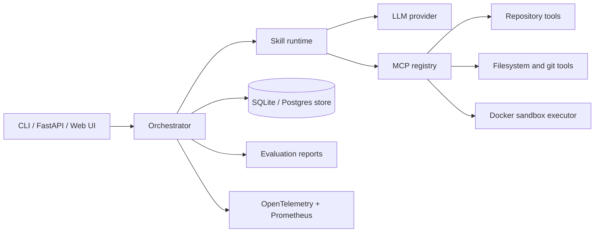

# ForgeAgent

ForgeAgent is an experimental software-engineering agent platform for studying
how orchestration, tools, review, and bounded repair loops affect task outcomes.
It provides four comparable agent architectures, an in-process MCP tool layer,
Docker-oriented execution isolation, and reproducible benchmark reports.

> ForgeAgent is research/development software. Generated patches require human
> review. The local executor is convenient for trusted fixtures but is not a
> security boundary.

## Architecture



Architectures A–D range from one role running the pipeline to specialized
planner, repository-analysis, coding, test, debugging, and review roles.
Every path has explicit iteration, tool-call, token, and wall-clock limits.
See [architecture](docs/architecture.md).

## MCP and skills

Tools are registered with JSON Schema inputs and invoked through policy,
validation, timeout, and redaction checks. Built-ins cover repository search,
bounded file access, git inspection, tests, and static inspection. Agent logic
uses eleven named skills rather than calling ad-hoc functions. See
[MCP](docs/mcp.md) and [agent skills](docs/agent-skills.md).

## Install

Python 3.12+ and `uv` are recommended:

```bash
uv sync --extra dev
```

Copy `.env.example` to `.env`. Offline local development defaults can be set
explicitly:

```text
FORGE_LLM_PROVIDER=mock
FORGE_SANDBOX_BACKEND=local
FORGE_TOOL_POLICY_DEFAULT=allow
```

## Local run

Run the API and open `http://localhost:8000/ui/`:

```bash
uv run uvicorn forgeagent.api.app:app --reload
```

Run one workspace task:

```bash
uv run forge task run . --title "Fix failing tests" \
  --architecture D_specialized_multi_agent
```

## Benchmark

The smoke benchmark starts from an intentionally broken calculator fixture and
runs all four architectures in isolated copies:

```bash
uv run forge benchmark run benchmarks/configs/smoke_calc.yaml
```

Each real invocation writes `result.json` and `report.md` beneath
`artifacts/experiments/<experiment-id>/`. Reported values are measured from
actual runs; this README intentionally contains no claimed benchmark numbers.
The repository includes an [actual smoke report](artifacts/experiments/exp_2f74caa295b1/report.md)
and an [example agent trace](artifacts/experiments/exp_2f74caa295b1/example_trace.json)
generated by the command above.
See [evaluation](docs/evaluation.md) and [experiments](docs/experiments.md).

## Sandbox and security

Docker is the intended boundary for untrusted repository code, with memory,
CPU, PID, timeout, and network controls. Local execution runs directly on the
host and must only be used with trusted code. Tool policy defaults to deny,
paths are constrained beneath a workspace root, and known secret patterns are
redacted. Review [security guidance](docs/security.md) before production use.

## Observability

ForgeAgent emits OpenTelemetry spans for task, agent, model, MCP, and execution
operations. Prometheus counters and histograms cover task outcomes, failures,
latency, tokens, and retries. The optional Compose stack includes an OTLP
collector, Prometheus, and Grafana.

## Limitations

- The deterministic mock coding behavior only repairs curated patterns.
- The API executes mock runs inline; a production deployment needs a durable queue.
- PostgreSQL, Redis, and telemetry services require separate deployment hardening.
- The Claude Code integration requires the real installed/authenticated CLI.
- Benchmarks demonstrate plumbing and reproducibility, not general SWE capability.

Additional documentation: [security](docs/security.md),
[Claude Code](docs/claude-code-integration.md), and
[experiment practice](docs/experiments.md).
